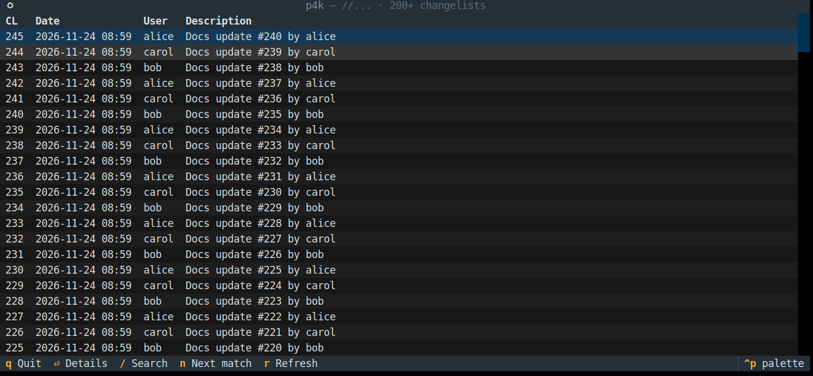
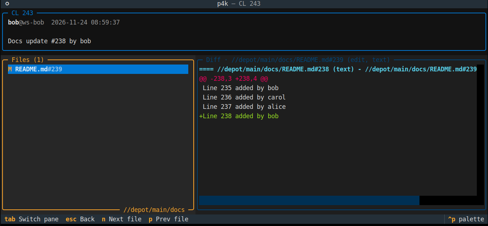

# p4k

A terminal changelist browser for Perforce (Helix Core), in the spirit of `gitk`/`tig`.





- List of submitted changelists (CL, date, user, description), loaded page by page as you scroll.
- `Enter` on a CL opens its details: description on top, affected files on the left, diff on the right.
- Diffs for edits, adds, deletes, moves and branches (moved/branched files are diffed against their source).

## Requirements

- Python 3.10+
- The `p4` command line client in `PATH`, already configured (P4PORT, P4USER, ... via environment, `p4 set` or P4CONFIG). p4k does not handle login; run `p4 login` first if needed.

## Install

With [pipx](https://pipx.pypa.io/) (recommended):

```sh
pipx install git+https://github.com/luciangutu/p4k.git
```

From a local checkout, for development:

```sh
python3 -m venv .venv
.venv/bin/pip install -e .
```

## Usage

```sh
p4k                          # all submitted CLs (//...)
p4k //depot/project/...      # history of a path
p4k -u alice                 # only CLs submitted by alice
p4k -m 500 //depot/main/...  # fetch 500 CLs per request
```

### Keys

Changelist list:

| Key | Action |
|---|---|
| `↑/↓`, `j/k`, `PgUp/PgDn` | Move |
| `g` / `G` | First / last loaded CL (reaching the end loads more) |
| `Enter` | Open CL details |
| `/` | Search the description or user. A bare number jumps to that CL |
| `n` / `N` | Next / previous match |
| `r` | Refresh |
| `q` | Quit |

Details:

| Key | Action |
|---|---|
| `Tab` | Switch focus between files and diff |
| `n` / `p` (or `]` / `[`) | Next / previous file |
| `Enter` on a file | Focus the diff |
| `Esc` / `q` | Back to the list |

## Development

`dev/seed.sh` starts a throwaway p4d in Docker (port 127.0.0.1:1777) and fills it with sample history (adds, edits, deletes, moves, branches, binary files and about 245 CLs from three users):

```sh
dev/seed.sh
source dev/env.sh            # points p4 at the local server
.venv/bin/python -m p4k
docker rm -f p4k-p4d         # cleanup
```

The p4d binary is downloaded from ftp.perforce.com on first run. It is not part of this repository and is subject to Perforce's own license terms.

Code layout:

```
p4k/p4client.py        p4 wrapper (p4 -G marshal output), caching, diff logic
p4k/models.py          dataclasses shared by the p4 layer and the UI
p4k/screens/changes.py changelist list screen
p4k/screens/detail.py  files + diff screen
p4k/app.py             Textual app and CLI
```

## License

MIT, see [LICENSE](LICENSE).

## Disclaimer

p4k is an independent open source project. It is not affiliated with, endorsed by, or sponsored by Perforce Software, Inc. "Perforce", "Helix Core" and "P4" are trademarks of Perforce Software, Inc.
